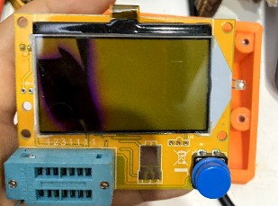
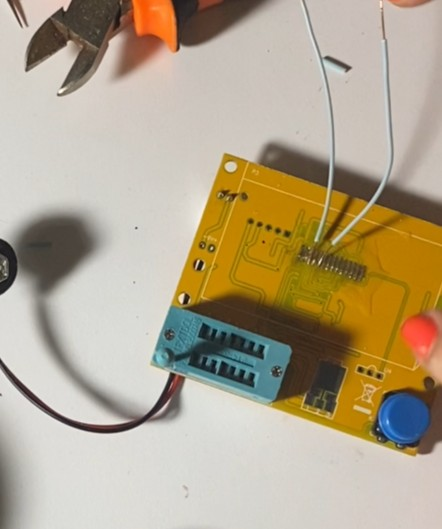

# LCR-T4 ekran değişimi — LGT8F328P yazılımı + 0,96" OLED

[English](README.md)

*Anahtar kelimeler: LCR-T4 ekran değişimi, kırık ekran tamiri, transistör test cihazı, komponent test cihazı, LGT8F328P, OLED ekran, yazılım yükleme, Arduino Uno ile programlama.*

| Bitmiş hâli: OLED orijinal kutusunda | ▶ Tamirin videosu |
|---|---|
|  |  |

Ekranı kırılan ucuz bir **LCR-T4 bileşen test cihazının** onarım notları,
yazılımı ve araçları. Yazısı zımparalanmış çipin altından **ATmega328P değil,
LGT8F328P** çıktı, üstelik kilitliydi. Bu depo kartın nasıl tanındığını,
sıradan bir **Arduino Uno** ile nasıl programlandığını anlatıyor. Orijinal
LCD yerine **0,96" SSD1306 I²C OLED** kullanan, çalışan bir m-firmware
derlemesi de içeriyor.

> ⚠️ Yazılım yüklemek fabrika yazılımını **kalıcı olarak siler**. Fabrika
> yazılımı kilitli olduğu için yedeklenemez. Cihaz zaten işe yaramıyorsa
> (ör. ekranı kırıksa) ya da orijinal yazılımı kaybetmeyi göze alıyorsan yap.

## Benim cihazım da böyle mi?

Büyük ihtimalle, eğer kartında:

- işlemcinin üstünde **okunabilir yazı yoksa** (LQFP-32),
- RESET, GND, VCC ve iki veri hattı olan **5 delikli** bir giriş varsa ama
  MOSI/MISO/SCK **yoksa**,
- ATmega328P varsayarak yaptığın ötme ölçümleri anlamsız çıkıyorsa.

`tools/LGT_ID_READ` ile kontrol et, hiçbir şey silmez. `3E A2 50 E9` çıkarsa
çip LGT8F328P ve kilitli demektir.

## Durum

| | |
|---|---|
| OLED ekran | ✅ çalışıyor |
| Dirençler | ✅ doğru ölçüyor |
| Kondansatörler | ✅ 100 nF seramik → 91 nF, 1 µF film → 905–945 nF (kalibrasyondan sonra) |
| Kalibrasyon + kayıt | ✅ çalışıyor, kapatıp açınca checksum hatası yok |
| Menü, sonucu ekranda tutma, otomatik kapanma | ✅ |
| Transistör, diyot, bobin, ESR, pil ölçümü | ⚠️ sistemli denenmedi |

## Önemli bilgiler

**SWD girişi** (1 = kare ped … 5): `1 SWC` · `2 SWD` · `3 RESET` · `4 GND` · `5 VCC`
→ Uno `D13` · `D12` · `D10` · `GND` · `5V`

**OLED** (SSD1306, I²C 0x3C): `SDA → PD1`, `SCK → PD2` (eski LCD şerit
kablosunun 3. ve 5. lehimi, SWD girişine yakın uçtan sayınca), `VDD → 5 V`, `GND → GND`.

| Eski LCD şerit kablo lehimleri, numaralı | OLED kabloları 3. ve 5. lehimde |
|---|---|
|  |  |

**Eski LCD'nin kullandığı hatlar:** PD0 (RES), PD1 (A0), PD2 (SCL), PD4 (SI).
PD3 ve PD5 ekrana bağlı değil.

**En önemli yazılım düzeltmesi:** LGT8F328P'de karşılaştırıcının `ACBG`/`C0BG`
biti bir bandgap referansı değil, **iç DAC'ı** seçiyor. DAC açılmazsa (1,024 V
iç referans, tam ölçek) küçük kondansatörler birkaç yüz pF ölçülüyor.

## Karşılaştığımız zorluklar (kısaca)

1. Çipin ATmega328P sanıldı. Ötme ölçümleri bu yüzden tutarsız çıktı. GND'ye
   sadece tek bacak ötüyordu ve 5 delikli girişte MOSI/MISO/SCK yoktu.
2. Probu deliğin **içine** sokunca ötmedi, deliğin **bakır halkasına**
   bastırınca öttü.
3. Kilitli bir LGT'yi LarduinoISP ile **okumaya** çalışmak bile çipi siliyor.
   Bu yüzden yalnızca kimlik okuyan ayrı bir araç yazıldı.
4. Uno'nun önyükleyicisi avrdude'a programlayıcıdan önce cevap veriyordu.
   Çözüm: programlayıcıyı 19200 baud'da çalıştırmak.
5. Yazma ilk sayfada takılıyordu. Arduino çekirdeği önbellekte 64 baytlık
   seri tamponla kalmıştı. `--clean` derleme ile çözüldü.
6. Minik çip bacakları yerine, her hatta farklı voltaj üreten bir "pin
   bulucu" yazılımla şerit kablo lehimleri multimetreyle eşlendi.
7. Kondansatörler 600 kat küçük ölçülüyordu. Sebebi yukarıdaki DAC meselesi.

Ayrıntılar: [docs/LESSONS.md](docs/LESSONS.md) (İngilizce).

## Kullanım

- **Ölçüm:** Parçayı "123" grubundaki yuvalara tak, düğmeye bas. Sonuç düğmeye
  basana kadar ekranda kalır.
- **Menü:** Sonuç ekrandayken düğmeye **iki kez hızlıca** bas. Menüde kısa bas
  = sonraki seçenek, uzun bas = seç.
- **Kapatma:** Düğmeye **uzun** bas. 60 saniye kullanılmazsa cihaz kendini
  kapatır.
- **Kalibrasyon:** Önce 100 nF – 3,3 µF arası bir film kondansatörü 3 kez ölç.
  Sonra menüden *Adjustment* → istendiğinde 1-2-3 uçlarını kısa devre et →
  istendiğinde çıkar → *Save*.

Yükleme adımları: [docs/FLASHING.md](docs/FLASHING.md). Kart notları:
[docs/HARDWARE.md](docs/HARDWARE.md).

## Teşekkürler ve lisans

m-firmware (Markus Reschke; Markus Frejek ve Karl-Heinz Kübbeler'in
çalışmalarına dayanır), LGT8F328P uyarlaması (Arnaud Durand), LGT düzeltmeleri
(CompuKit TC1), lgt8fx çekirdeği ve LarduinoISP (dbuezas, brother_yan).
Yazılım **EUPL v1.1** lisanslıdır (bkz. `LICENSE`).

**Garanti yoktur.** Ölçüm uçları korumasızdır. Enerjili bir devreye ya da dolu
bir kondansatöre bağlama.
