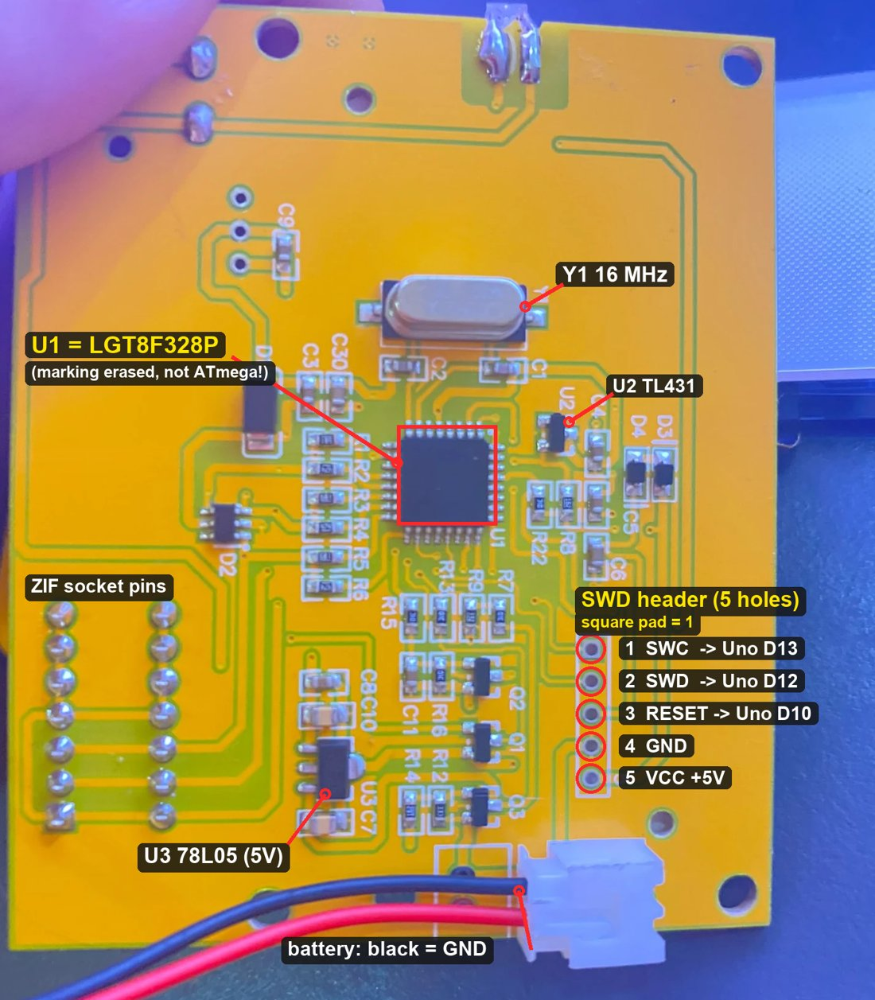
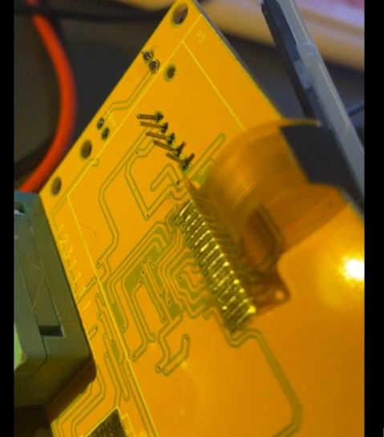

# Flashing the LGT8F328P with an Arduino Uno

> ⚠️ **This destroys the factory firmware.** It is read-protected and can't
> be backed up. The first SWD connection of LarduinoISP erases a locked chip.
> Flashing also erases the calibration (emulated EEPROM), so run the
> self-adjustment again afterwards.

Tested with: Windows 10, arduino-cli 1.x, Arduino AVR core 1.8.7
(avr-gcc 7.3.0), avrdude 8.0-arduino.1, lgt8fx core 2.0.7, a Uno clone on COM3.

## 1. Install the lgt8fx core

Boards Manager URL:
`https://raw.githubusercontent.com/dbuezas/lgt8fx/master/package_lgt8fx_index.json`

```
arduino-cli core update-index --additional-urls <URL>
arduino-cli core install lgt8fx:avr --additional-urls <URL>
python tools/setup_lgt_tools.py
```

## 2. (Optional but recommended) Identify the chip without erasing it

Upload `tools/LGT_ID_READ` to the Uno, wire it as below, open a serial
monitor at 115200 baud:

- `3E A2 50 E9` → LGT8F328P, locked
- `3F A2 50 E9` → LGT8F328P, unlocked
- `00 00 00 00` / other → swap SWC/SWD, check wiring, or it's not an LGT

## 3. Wiring





*Tip: a short pin header soldered into the 5 SWD holes makes repeated programming easy.*

Battery **out**. The Uno powers the tester.

| Uno | LCR-T4 |
|---|---|
| 5V | hole 5, or the output leg of U3 (78L05) |
| GND | hole 4, or the battery-minus solder joint |
| D10 | hole 3 (RESET) |
| D12 | hole 2 (SWD) |
| D13 | hole 1 (SWC) |

## 4. Programmer sketch on the Uno

Build and upload `tools/LarduinoISP_19200` **clean** with a 250-byte RX
buffer (exact commands and the reasons in
[tools/LarduinoISP_19200/README.md](../tools/LarduinoISP_19200/README.md)).

## 5. Write the firmware

```
avrdude -C <avrdude.conf> -p atmega328p -c stk500v1 -P COM3 -b 19200 ^
  -U flash:w:firmware/prebuilt/LCR-T4_LGT8F328P_SSD1306-I2C_m1.42m.hex:i
```

Expected: about 20 s writing, 16 s reading, `26802 bytes of flash verified`.

The signature check passes because LarduinoISP returns a fixed ATmega328P
signature. It isn't the chip's real ID.

## 6. First start and self-adjustment

1. Remove the Uno wires (at least 5V and D10), insert the 9 V battery, press
   the button.
2. `Checksum error` on the first start is expected (empty EEPROM).
3. Measure a **film capacitor 100 nF – 3.3 µF** three times. The firmware
   tunes its reference and comparator offsets from it.
4. Menu: with a result on screen, **press the button twice quickly**.
   (A **long** press switches the tester **off**.) In the menu: short press =
   next item, long press = select.
5. **Adjustment**: when asked, short probes 1-2-3. A three-legged "fork"
   made of resistor legs is the easiest way. Remove the short when asked.
6. **Save** → profile #1. Power-cycle: no more checksum error.

## Building the firmware yourself

```
cd firmware
python build.py
```

It produces `firmware/build/ComponentTester.hex`. This must be byte-identical
to the prebuilt file. The script refuses images above 30 720 bytes (the last
2 KB of flash hold the emulated EEPROM).
