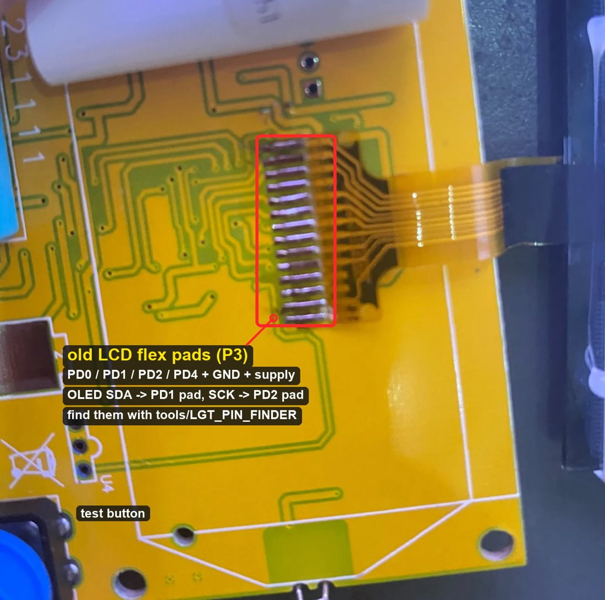
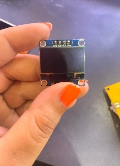
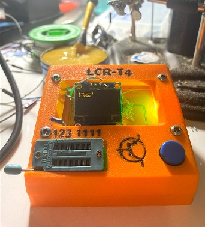

# Hardware notes — LCR-T4 clone with LGT8F328P

Everything here was **measured on one board** (yellow PCB, 9 V battery,
turquoise ZIF socket printed `123 1111`, broken 128×64 monochrome LCD on a
flex cable). Other clones may differ. Verify before you solder.

## Parts found on the board

| Ref | Marking | What it is | Notes |
|---|---|---|---|
| U1 | **erased** (LQFP-32) | **LGT8F328P** | Identified via SWD ID `3E A2 50 E9` (see below). Looks like an ATmega328P, but it isn't. |
| Y1 | `16.000000` KONEX | 16 MHz crystal | The LGT runs from its internal 32 MHz RC after reset. The firmware switches to this crystal. |
| U2 | `431` | TL431 | 2.5 V precision reference |
| U3 | `78L05` (SOT-89) | 5 V regulator, ~100 mA | Fed from the 9 V battery through the power-latch transistors |
| — | 5-hole row, square pad at one end, `5` printed at the other | **SWD programming header** (not AVR ISP!) | Pinout below |
| P3 | ~13 pads, front side | Flex of the original LCD | Pad mapping below |

Hint: there is **no** MOSI/MISO/SCK on the 5-hole header. If you are looking
for an AVR ISP header on this board, there is none. That was the first clue
that the MCU isn't an ATmega.

## How the MCU was identified

1. **Continuity to GND (battery minus):** only **one** MCU leg beeped. On an
   ATmega328P (TQFP-32), pins 3, 5 and 21 are all GND, so at least two should
   beep. On the LGT8F328P some of those positions are other functions.
2. **The 5-hole header** has RESET, GND, VCC and **two** data lines. That matches
   the LGT SWD interface (SWC/SWD), not AVR ISP.
3. **SWD ID read** with an Arduino Uno and `tools/LGT_ID_READ` (read-only):
   `3E A2 50 E9` = LGT8F328P, **locked** (`3F A2 50 E9` = unlocked).

The factory firmware is read-protected. Unlocking the chip needs a chip erase,
so **the original firmware can't be backed up**.

## SWD header pinout (5 holes)

Number the holes `1` = square pad … `5` = end with the printed `5`.

| Hole | Signal | Uno (LarduinoISP) | Verified by |
|---|---|---|---|
| 1 | **SWC** | D13 | Working SWD communication |
| 2 | **SWD** | D12 | Working SWD communication |
| 3 | **RESET** | D10 | Continuity to MCU leg 29 (RESET position) |
| 4 | **GND** | GND | Continuity to battery minus |
| 5 | **VCC** (+5 V) | 5V | Continuity to MCU leg 4 (VCC position) |

The holes are plated, but a probe pushed **into** the hole often doesn't
touch. Press the probe on the **copper ring** around the hole. The first round
of measurements reported "nothing beeps" only because of this.

Programming power: don't use the 9 V battery while programming. The board's
power latch (PD6) is released while the MCU is held in reset. Feed **5 V from
the Uno** into the 5 V rail instead, either via hole 5 or via the output leg
of U3 (78L05). Find that leg with continuity to hole 5.

## Original LCD flex (P3) — which pad is which MCU pin

The pad numbers below were counted from one end of this row. The direction wasn't
recorded, so re-check on your board with the pin finder before soldering.

Found with `tools/LGT_PIN_FINDER`, which gives every PD pin a different average
voltage, and a multimeter on DC volts. That way only big pads are probed, never
the 0.5 mm-pitch legs. Pads numbered from one end of the row:

| Pad | Measured | Signal |
|---|---|---|
| 2 | 0.505 V | **PD0** (LCD RES) |
| 3 | 1.430 V | **PD1** (LCD A0/RS) → used as OLED **SDA** |
| 4 | 0 V | GND (probably) |
| 5 | 2.353 V | **PD2** (LCD SCL) → used as OLED **SCK** |
| 6, 7 | ~4.1 V | one is **PD4** (LCD SI), the other a supply line (not resolved) |
| others | ~0 V | — |

**PD3 and PD5 are not routed to the LCD.** That's why the usual T4 mappings
(PD3 = SI, PD5 = CE) didn't beep. The mapping PD0/PD1/PD2/PD4 is the same as
on the LCR-TC1 (see CompuKit TC1).

## Rest of the tester hardware

Assumed from the m-firmware LGT config and the CompuKit TC1 notes. The
working resistor and capacitor measurements confirm it in practice:

| Function | Pin |
|---|---|
| Test pins TP1 / TP2 / TP3 | PC0 / PC1 / PC2 |
| Rl 680 Ω to TP1 / TP2 / TP3 | PB0 / PB2 / PB4 |
| Rh 470 kΩ to TP1 / TP2 / TP3 | PB1 / PB3 / PB5 |
| 2.5 V reference (TL431) | PC4 |
| Battery (divider) | PC5 |
| Power latch | PD6 |
| Test button | PD7 |

ZIF socket `123 1111`: the left three columns are probes 1, 2, 3. The four
columns on the right are all probe 1 (extra holes for wide parts).

## New display: 0.96" SSD1306 I²C OLED

 

Module **GM009605** (blue, 4 pins `GND VDD SCK SDA`, Q1 regulator, R1/R2
pull-ups, R3 = address 0x3C). It runs from 5 V and needs no series resistors.
The firmware drives I²C open-drain (DDR only), and the pull-ups are on the
module.

| OLED | LCR-T4 |
|---|---|
| GND | hole 4 (GND) |
| VDD | hole 5 (VCC, +5 V) |
| SDA | flex pad 3 (PD1) |
| SCK | flex pad 5 (PD2) |

The broken LCD was left connected on its flex and didn't disturb the I²C bus.
If you see I²C problems, cut the old flex.

Only SSD1306 is supported. 1.3" OLEDs usually have an SH1106 instead. m-firmware
has an SH1106 driver too (not tested here).
